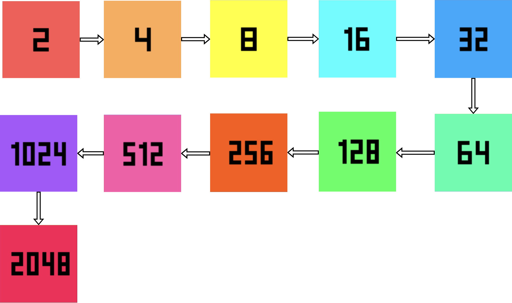
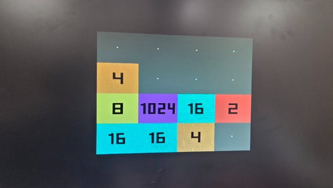
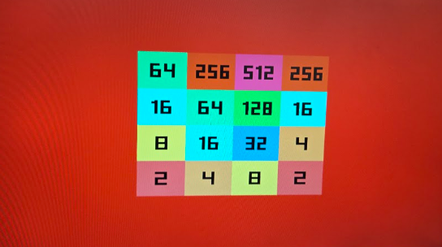
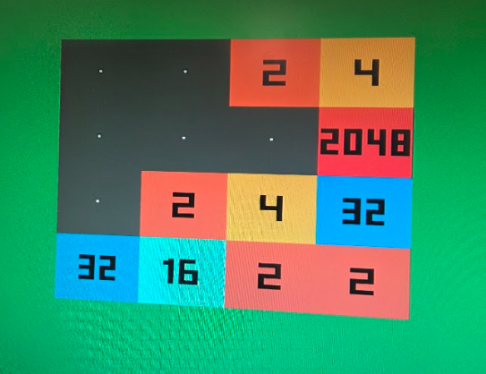
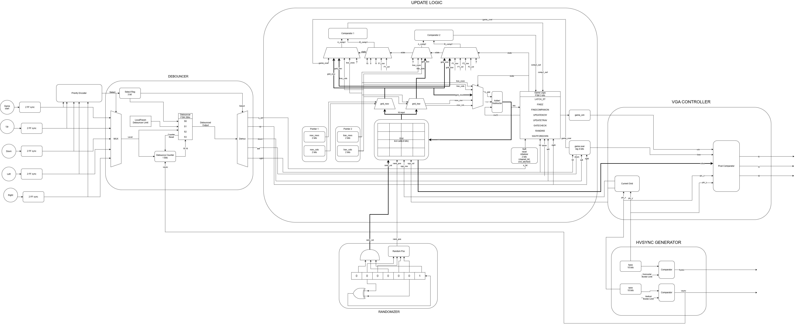
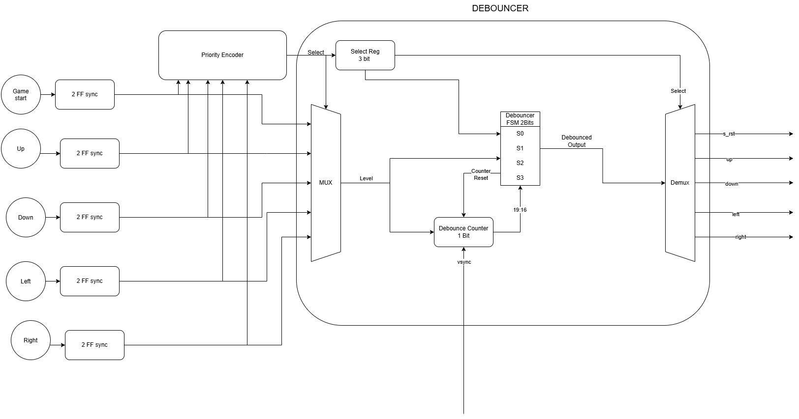
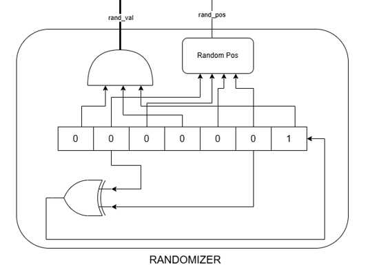
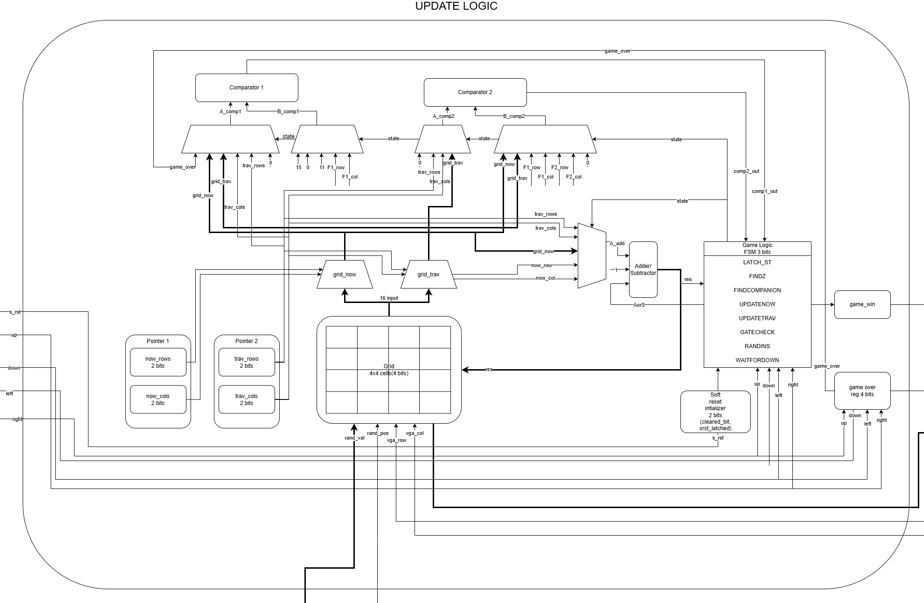
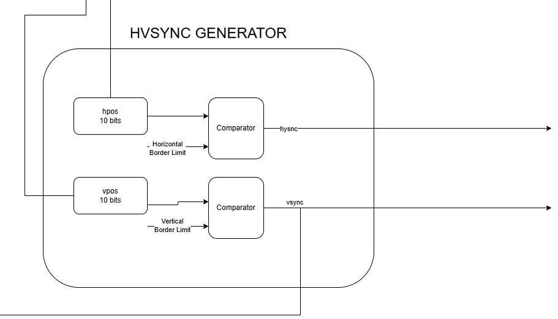
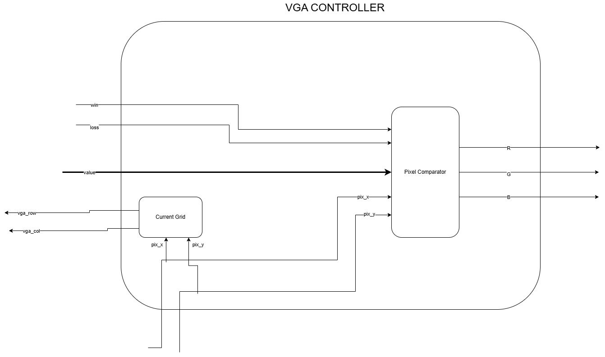

# Hardware-Accelerated-2048-VGA-Game

A hardware implementation of the classic **2048 puzzle game**, with game logic implemented in RTL and real-time video output through a VGA display.

## Overview

2048 is a tile-merging puzzle played on a 4×4 grid. Each tile represents a power of two. The player moves the tiles up, down, left, or right; tiles with matching values merge into a tile with twice the value. A new tile appears after a successful move. The objective is to create a tile with the value **2048** without running out of valid moves.

The directional buttons and restart button are debounced before reaching the game logic. The game engine updates the 4×4 grid, handles tile movement and merging, generates new tiles, and detects win/loss conditions. The VGA controller reads the grid and game status and generates the synchronization and RGB signals needed to display the game.

Tiles are stored internally using a 4-bit exponent representation rather than their displayed numeric values: `0` represents an empty cell, `1` represents 2, `2` represents 4, and so on up to `11`, which represents 2048. This makes merging two equal tiles an increment of the stored value.

## Features

- **4×4 game grid** with 4-bit tile encoding.
- **Directional movement** in all four directions: up, down, left, and right.
- **Tile shifting and merging**, using a destination pointer (`now`) and a traversal pointer (`trav`).
- **Shared arithmetic and comparison hardware**: two equality comparators and one shared adder/subtractor are reused by the game-control FSM.
- **Pseudorandom tile generation** after a successful move and at game restart, inserting a 2 (approximately 90%) or a 4 (approximately 10%).
- **Button debouncing** for all five game buttons: up, down, left, right, and soft reset.
- **Frame-based button sampling**: buttons must be stable for two consecutive frames. The effective latency is approximately 1–2 frames (16–33 ms at 60 FPS); presses shorter than approximately 16 ms may be missed.
- **Win detection** when a merge produces the 2048 tile.
- **Game-over detection** using a four-bit vector that tracks unsuccessful moves in each direction.
- **Visual game status**: a green grid border indicates a win, while a red grid border indicates a loss.
- **Hard reset and soft restart** support.
- **VGA output** at 640×480, approximately 60 FPS, with a 25.175 MHz pixel clock and 2 bits per RGB colour channel.

## Demo

  
   
  <em>Gameplay sequence</em>

  
   
  <em>2048 game during gameplay</em>

  
   
  <em>Game over</em>

  
   
  <em>Game win</em>

## Architecture

The five game inputs (up, down, left, right, and soft reset) pass through the debouncer (priority given in this order: soft reset, up, down, left , right). No new inputs will be accepted untill all buttons are deasserted. The game logic (`update.v` and `randomizer.v`) processes player input and updates the grid and win/loss status. The VGA logic (`vga_controller.v` and `hvsync_generator.v`) uses the grid and status signals to generate the displayed pixels and VGA synchronization signals.

  
   
  <em>Complete Architecture</em>

[View the architecture diagram](https://drive.google.com/file/d/1NTIYlzZV2jmrTexMhQgzDGUUGLBoHh4L/view?usp=sharing)

  
   
  <em>Shared Debouncer architecture</em>

  
   
  <em>Pseudorandom tile position and value generator</em>

  
   
  <em>Game update logic</em>

  
   
  <em>Horizontal and vertical synchronization generator</em>

  
   
  <em>VGA controller</em>

## Top-Level Interface

### Input Ports

| Signal | Purpose |
|---|---|
| `ui_in[7:5]` | Unused |
| `ui_in[4:0]` | {soft_reset, right, left, down, up} |
| `uio_in[7:0]` | Unused |
| `ena` | always 1 when the design is powered |
| `clk` | clock - 25.175 MHz |
| `rst_n` | active low reset |

### Output Ports

| Signal | Purpose |
|---|---|
| `uo_out[7:0]` |  {hsync, B[0], G[0], R[0], vsync, B[1], G[1], R[1]} |
| `uio_out[7:0]` | Unused, tied to 0 |
| `uio_oe[7:0]` | Unused, tied to 0 |

### Main RTL blocks

| Module | Responsibility |
|---|---|
| [`debounce_top.v`](src/debounce_top.v) | Debounces the five game buttons before they are used by the game logic. |
| [`update.v`](src/update.v) | Implements the game FSM, grid updates, tile movement and merging, and win/loss detection. |
| [`randomizer.v`](src/randomizer.v) | Generates pseudorandom tile positions and supports random tile insertion. |
| [`vga_controller.v`](src/vga_controller.v) | Reads the game grid and generates the pixel colour output, including the win/loss border. |
| [`hvsync_generator.v`](hysync_generator.v) | Generates horizontal and vertical VGA synchronization and pixel-coordinate timing. |

## How It Works

1. The clock drives the debouncer, game engine, randomizer, and VGA timing logic.
2. The five game buttons are sampled once per video frame. A button must remain stable across two consecutive frames to be accepted.
3. Priority Order - (Soft Reset, Up, Down, Left, Right)
4. A directional input starts a game update. The FSM uses the `now` pointer to identify the destination cell and the `trav` pointer to scan the row or column for tiles to move or merge.
5. The shared comparators check for empty cells, matching tiles, pointer boundaries, and the win condition. The shared adder/subtractor advances pointers or increments a tile's exponent during a merge.
6. The grid is updated when the FSM asserts the grid-write control. If the move changes the board, a new random tile is inserted into an empty location (10% probability for 4, 90% probability for 2).
7. The VGA controller reads the grid and renders the game. A green border indicates a win, and a red border indicates a loss.

After power-on or a hard reset, the grid is cleared. Once `rst_n` is released, the VGA display becomes active and shows the empty grid. Press the soft reset button to start a game and insert the first random tile. Use the directional buttons to play.

## Running the Project

### External hardware

- An FPGA board programmed with this design.
- A VGA display or other VGA sink supporting **640×480 at approximately 60 Hz**, with a **25.175 MHz pixel/dot clock**.
- Five push buttons for up, down, left, right, and soft reset, along with the board's active-low hard-reset input.

### How to test

1. **Power-on/hard reset:** Assert `rst_n` low. The game state and grid are cleared, and the VGA output is inactive while reset is asserted.
2. **Release hard reset:** Release `rst_n`. The VGA display should show a grey 4×4 grid in the centre against a black background.
3. **Restart:** Press the soft reset button. A random starting tile (2 or 4) should appear.
4. **Directional movement:** Test each direction and check that tiles shift and merge in the correct direction without visual glitches.
5. **Tile insertion:** After a successful move, check that a new 2 or 4 tile appears in an empty cell.
6. **Game-over condition:** Exercise unsuccessful moves in all four directions and confirm that the loss condition is indicated by a red border.
7. **Win condition:** Create a 2048 tile and confirm that the win condition is indicated by a green border. Further directional moves should not change the game until it is restarted.
8. **Button debounce:** Check that normal button presses are detected and that very short presses may be missed, as expected from the frame-based debounce interval.

## Limitations

1. **One tile is inserted at restart.** The board starts with one randomly placed tile after the soft reset sequence.
2. **Game-over tracking is direction-based.** The RTL uses a four-bit vector with one flag per direction and asserts game-over when all four direction flags have been set by moves that do not change the grid. This is not the standard rule of declaring game-over immediately when no legal move remains. Repeating a failed move in the same direction does not set a different direction flag.

## Contributors

| Name | GitHub | Contributions |
|---|---|---|
| Ayush Verma | [@AyushVerma17](https://github.com/AyushVerma17) | Debouncer Logic + Optimization |
| Joshua Quinthino Albuquerque | [@JOSHUA5227](https://github.com/JOSHUA5227) | Streamlined Architecture + Alternative Game Logic + FPGA |
| Tamil Selvan| [@VERYsmallBOI](https://github.com/VERYsmallBOI) | Streamlined Architecture + Final Game Logic + Randomizer |
| Neti Udaya Karthikeya | [@karthikeyaneti](https://github.com/karthikeyaneti) | VGA Logic + Integration |

